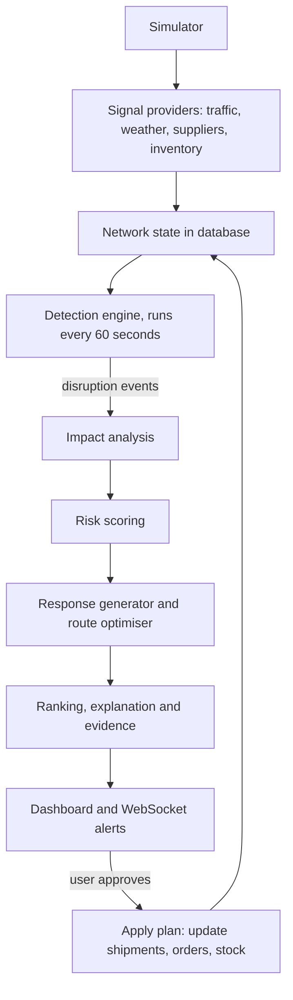

# SupplySense: Supply-Chain Risk and Route Management Prototype
### Build specification and prompt for an AI coding assistant

---

## 0. Instructions to the AI builder (read first)

You are building a working, software-only prototype of a decision-support platform. Read this whole document before writing code.

Rules:
1. The work is split into a BACKEND track and a FRONTEND track (section 13) so two people can build at the same time. You will be told which track you are on. Build only that track, stay inside your own folders, and treat `contracts/` as the shared interface.
2. Within your track, work slot by slot. Do not start the next slot until the current slot is complete and its tests pass. At the end of each slot: run your track's tests, show the real output, and deliver the code as a downloadable zip with a short note on what changed and how to run it.
3. Never fake a data source. Where a real API is unavailable or unreliable, use a clearly labelled simulated provider behind the same interface, and say so in the UI and README.
4. Every number shown in the UI must be computed by code from stored data. An LLM, if used at all, only rephrases explanations from structured facts and must never invent numbers. The system must work fully with no LLM key (template explanations).
5. Keep every threshold, weight and constant in one config file (`backend/app/config.py` plus `.env`). No magic numbers in logic.
6. Make the system deterministic when a seed is set, so tests and demos are repeatable.
7. If something is ambiguous, state your assumption in one line and continue. Ask at most one question if truly blocked.
8. No hardware, no paid APIs required. Everything must run on one laptop.

---

## 1. Problem statement and goal

Hackathon problem: **Intelligent Supply-Chain Risk and Route Management.**
Build a system that detects disruptions caused by traffic, weather, supplier delays or inventory shortages and recommends better routes or actions.
Expected outcome: a decision-support platform that identifies supply-chain risks and recommends an appropriate response.

One-line pitch: *"A control tower that watches the whole supply network, detects disruptions before they hurt, and recommends the best reroute or action, with the evidence and trade-offs shown."*

Constraint: software only.

---

## 2. Success criteria (what a judge should be able to verify)

1. The platform continuously monitors a realistic demo network and shows its live state on a map.
2. It detects all four disruption types: traffic, weather, supplier delay, inventory shortage.
3. For each disruption it shows impact: affected shipments, delay, stockout date, revenue at risk.
4. It recommends actions (reroute, alternate supplier, expedite, rebalance stock, increase safety stock, or monitor) ranked by time, cost and risk, with a plain-language explanation and the evidence behind it.
5. The user can approve an action and see the network update (closed loop).
6. A built-in simulator can inject a disruption live, so the demo does not depend on real-world events.
7. An evaluation script reports measurable results (detection precision and recall, recommendation quality) on a fixed scenario set.

---

## 3. Scope

In scope (build these):
- Overview dashboard (map, KPIs, active risks by cause, recent disruptions, recommended actions)
- Risk Monitor page (list and detail of disruptions with evidence)
- Route Planning page (current vs recommended route comparison, priority sliders, approve)
- Shipments and Suppliers pages (simple tables)
- Disruption simulator (drawer or modal)
- Detection engine, impact analysis, risk scoring, response generator, route optimiser
- Evaluation script and test suite

Out of scope (do not build): Analytics page, Reports page, authentication, multi-user roles, real ERP integration, real-time vehicle tracking, global multimodal sea/air routing, geopolitical risk, customs delay. Remove these from the navigation and charts. Do not show categories the system cannot actually detect.

---

## 4. Workflow



Step by step:
1. **Ingest.** Providers fetch or simulate traffic, weather, supplier delivery performance and inventory levels, and write timestamped signals to the database.
2. **Detect.** The detection engine runs on a schedule and on demand. It applies rules and statistical checks (section 7) and creates or updates disruption events with a severity from 0 to 1.
3. **Impact.** For each disruption, find affected shipments and stores, estimate extra delay, stockout date and revenue at risk (section 8).
4. **Score.** Combine severity and exposure into a 0 to 100 risk score and a Low, Medium or High level, plus a confidence value.
5. **Respond.** Generate candidate actions and evaluate each on time change, cost change and residual risk (section 9).
6. **Recommend.** Rank candidates, keep the top 3, attach a template explanation and the evidence list.
7. **Present.** Push the event and recommendations to the UI over WebSocket.
8. **Act.** When the user approves a recommendation, apply it to the data (new route for a shipment, new supplier order, stock transfer) and re-run detection to show the risk drop.

---

## 5. Tech stack

| Layer | Choice | Notes |
|---|---|---|
| Backend language | Python 3.11+ | |
| API framework | FastAPI + Uvicorn | REST plus WebSocket |
| Validation | Pydantic v2 | Typed request and response models |
| Database | SQLite for dev (SQLAlchemy 2.x ORM); PostgreSQL optional | Use Alembic or simple create_all for the prototype |
| Scheduler | APScheduler (or an asyncio background task) | Detection every 60 s, configurable |
| Graph and routing | NetworkX | Dijkstra and `shortest_simple_paths` for k alternative routes |
| Statistics | NumPy, pandas, scikit-learn (optional) | z-scores for supplier drift; IsolationForest optional, not required |
| HTTP client | httpx (async) | Timeouts, retries, caching |
| Weather | Open-Meteo forecast API | Free, no key |
| Road routing (build time only) | OSRM public demo server | Used once by `scripts/build_network.py` to cache geometry; runtime never depends on it |
| Traffic | Simulated provider behind `TrafficProvider` interface | No free live-traffic API; be honest about this in UI and README |
| Supplier and inventory data | Synthetic generator with fixed seed | Realistic distributions |
| LLM (optional) | Any provider via env var | Only to phrase explanations from structured facts; template fallback always works |
| Frontend | Next.js 14 (App Router) + TypeScript + Tailwind CSS | |
| Map | react-leaflet + OpenStreetMap tiles | Dynamic import with `ssr: false`; follow the tile usage policy |
| Charts | Recharts | Donut and bars |
| Client data | TanStack Query for REST, a small custom hook for WebSocket | |
| Testing | pytest, pytest-asyncio, httpx TestClient; Playwright for one smoke test (optional) | |
| Packaging | docker-compose (optional) plus plain `make dev` / `npm run dev` instructions | |

---

## 6. Demo network and seed data

Use a regional road network so that real geography, real weather and cached real road geometry all work. Default region: India.

Locations (name, lat, lng, type):
- Suppliers: Ludhiana (30.9010, 75.8573), Pune (18.5204, 73.8567), Surat (21.1702, 72.8311), Chennai (13.0827, 80.2707)
- Warehouses (hubs): Delhi NCR (28.6139, 77.2090), Nagpur (21.1458, 79.0882), Bengaluru (12.9716, 77.5946)
- Stores: Mumbai (19.0760, 72.8777), Kolkata (22.5726, 88.3639), Hyderabad (17.3850, 78.4867), Jaipur (26.9124, 75.7873), Lucknow (26.8467, 80.9462), Ahmedabad (23.0225, 72.5714)

Network graph:
- Nodes are locations. Edges are road lanes in both directions.
- Connect every hub to every other hub, connect each supplier to its 3 nearest hubs, and connect each store to its 3 nearest hubs.
- `scripts/build_network.py` calls OSRM once per lane to store `distance_km`, `baseline_duration_s` and a simplified `geometry` (GeoJSON LineString) in `backend/data/network.json`. Commit this file.
- If OSRM is unreachable at build time, fall back to haversine distance times 1.3, average speed 50 km/h, and a straight polyline. Mark such lanes `approximate: true`.
- Cost per lane = `distance_km * cost_per_km + fixed_cost` (config).

Catalogue and operations (seed with a fixed random seed):
- 8 SKUs with price, margin, average daily demand per store.
- Initial inventory per warehouse and store, giving 5 to 20 days of cover.
- 12 to 15 in-transit shipments, each with SKU, quantity, supplier, origin, destination, planned route (list of lane IDs), ETA.
- 60 days of supplier delivery history per supplier (lead-time mean and spread; one supplier slightly unreliable).
- Replenishment lead time per SKU and supplier.

---

## 7. Detection rules (all thresholds in config)

Each rule outputs `type`, `entity` (lane, supplier or location+SKU), `severity` in [0, 1], `confidence` in [0, 1] and an `evidence` object.

**Weather (per lane).**
- Sample up to 6 points along the lane geometry, roughly every 75 km. Request one Open-Meteo call with multiple coordinates, hourly forecast for the next 48 hours. Cache 30 minutes.
- `precip_score = min(precip_mm_per_h / 20, 1)`, `wind_score = min(gust_kmh / 90, 1)`, thunderstorm weather codes (95 to 99) give score 1.0.
- `severity = max(precip_score, wind_score, storm_score)` over points and the next 24 hours. Medium at 0.5, High at 0.75.
- Confidence base 0.7.

**Traffic (per lane).**
- `ratio = current_duration / baseline_duration`. Medium at 1.25, High at 1.5.
- `severity = clamp((ratio - 1) / 0.8, 0, 1)`.
- Simulated provider: `ratio = 1 + 0.35 * rush_hour_bump(time_of_day_IST) + noise(seed)`, multiplied by any active simulated incident on the lane. Confidence base 0.6, because simulated.
- Keep a `TrafficProvider` interface so a real provider can be dropped in.

**Supplier delay (per supplier).**
- Compare the last 7 days of lead-time delay with the previous 30 days. `z = (recent_mean - baseline_mean) / baseline_std`. Also compute on-time rate.
- Medium if `z >= 1.5` or on-time rate below 85%. High if `z >= 2.5` or on-time rate below 70%.
- `severity = clamp(z / 4, 0, 1)`. Confidence = `min(1, n_deliveries / 20)`.

**Inventory shortage (per location and SKU).**
- `days_of_cover = on_hand / avg_daily_demand`. `effective_lead_time = replenishment_lead_time + current_supplier_delay_days`.
- Medium if `days_of_cover < effective_lead_time + safety_buffer_days`. High if `days_of_cover < effective_lead_time`.
- `severity = clamp(1 - days_of_cover / (effective_lead_time + safety_buffer_days), 0, 1)`. Confidence 0.95.

De-duplication: one open disruption per (type, entity). Update it while the condition persists, mark it resolved after it clears for 3 consecutive runs. Add corroboration: when two independent signals hit the same lane or location (for example weather and traffic), add 0.1 to confidence, capped at 1.

---

## 8. Impact analysis and risk scoring

For each disruption:
- **Affected shipments:** shipments whose planned route uses the affected lane, or whose supplier is delayed, or whose destination SKU is short.
- **Extra delay (hours):** for lanes, `baseline_hours * (delay_factor - 1)` where delay_factor comes from the traffic ratio or a weather factor (`1 + severity`); for suppliers, the measured delay; for inventory, 0 (the stockout date is the impact).
- **Stockout date:** `now + days_of_cover`, adjusted by any extra delay on inbound shipments.
- **Units short:** `max(0, demand_until_new_ETA - on_hand)`.
- **Revenue at risk:** `units_short * price`. Also report margin at risk.

Risk score (0 to 100):
```
exposure = min(1, revenue_at_risk / exposure_cap)        # exposure_cap in config
risk_score = 100 * severity * (0.4 + 0.6 * exposure)
level = Low (<35), Medium (35 to 65), High (>65)
```
Report `confidence` separately and show it in the UI. Never hide low confidence.

---

## 9. Response generation and ranking

Candidate actions (generate every feasible one):
1. **REROUTE:** for affected shipments, compute up to 3 alternative paths with NetworkX `shortest_simple_paths` using a risk-adjusted edge weight:
   `w = duration_s * (1 + traffic_delay_factor) + cost_weight * cost + risk_weight * lane_risk_score * duration_s`
   Compare each alternative with the current route.
2. **ALTERNATE_SUPPLIER:** suppliers able to provide the SKU, scored on lead time (including current delay), cost premium and reliability.
3. **EXPEDITE:** faster mode at a cost multiplier and a time reduction factor (config).
4. **REBALANCE:** transfer stock from a warehouse with surplus cover (cover above target) to the short location, using the road graph for transfer time and cost.
5. **INCREASE_SAFETY_STOCK:** raise the reorder level for the SKU for a period; cost = holding cost.
6. **MONITOR:** do nothing; always included as a baseline with its own projected delay and revenue loss.

For each candidate compute: `delay_saved_hours`, `cost_delta`, `risk_reduction` (drop in projected risk score), `feasible` (capacity and stock checks) and `confidence`.

Ranking: normalise each metric to 0 to 1 across the candidate set, then
`utility = w_time * norm(delay_saved) + w_cost * (1 - norm(cost_delta)) + w_risk * norm(risk_reduction)`
with default weights 0.4, 0.3, 0.3. The Route Planning page has a priority control (Fastest, Balanced, Cheapest, Safest) that changes the weights and re-ranks live. Keep the top 3 plus the MONITOR baseline.

Explanation (template-based, always available), for example:
"Reroute shipment S-104 via Nagpur instead of Delhi NCR. This avoids heavy rain forecast on the Delhi to Jaipur lane, saves about 6 h, costs about 4% more, and lowers the risk score from 78 to 31."
Every explanation must list its evidence: event IDs, data values, source (provider name, simulated or real) and timestamp. An optional LLM step may paraphrase the template text but may not change any number; if the LLM output contains a number not in the facts, discard it and use the template.

---

## 10. Data model, API and WebSocket

Tables (SQLAlchemy models):
- `locations(id, name, type, lat, lng)`
- `lanes(id, from_id, to_id, distance_km, baseline_duration_s, cost, geometry_json, approximate)`
- `suppliers(id, name, location_id, base_lead_time_days, reliability)`
- `products(sku, name, price, margin, replenishment_lead_days)`
- `inventory(location_id, sku, on_hand, avg_daily_demand)`
- `shipments(id, supplier_id, origin_id, destination_id, sku, qty, route_lane_ids_json, status, planned_eta, current_eta)`
- `supplier_deliveries(id, supplier_id, promised_at, delivered_at, delay_hours)`
- `signals(id, ts, source, kind, entity_type, entity_id, value_json, simulated)`
- `disruptions(id, type, entity_type, entity_id, severity, confidence, risk_score, level, status, detected_at, resolved_at, evidence_json)`
- `impacts(id, disruption_id, affected_shipments_json, extra_delay_h, stockout_date, units_short, revenue_at_risk)`
- `recommendations(id, disruption_id, action_type, params_json, delay_saved_h, cost_delta, risk_reduction, utility, rank, explanation, evidence_json, status)`
- `audit_log(id, ts, event, payload_json)`

REST endpoints (prefix `/api`):
- `GET /health`
- `GET /overview` (KPIs, counts by cause, regional summary, recent disruptions, top recommendations)
- `GET /network` (locations, lanes with geometry and current risk)
- `GET /disruptions?status=open&type=...` and `GET /disruptions/{id}` (with impact, evidence, recommendations)
- `GET /shipments`, `GET /suppliers`
- `GET /routes/compare?shipment_id=...&priority=balanced` (current vs top alternatives with metrics and geometry)
- `GET /recommendations?disruption_id=...`
- `POST /recommendations/{id}/approve` (applies the action, logs it, re-runs detection, returns the before and after risk)
- `POST /detect/run` (manual trigger)
- `POST /simulate` with `{scenario_id}` or a custom payload; `POST /simulate/reset`

WebSocket `/ws/alerts`: server pushes `disruption_created`, `disruption_updated`, `disruption_resolved`, `recommendation_ready`, `plan_applied`. Include a reconnect with backoff on the client.

---

## 11. UI specification

Use the supplied dashboard mockup as the layout reference (warm cream palette, left sidebar, map centre, cards around it). Do not copy it pixel by pixel; match structure and tone.

Navigation (left sidebar): Overview, Risk Monitor, Route Planning, Shipments, Suppliers. Remove Analytics and Reports.

Overview page:
- Header: title, search box, notifications bell with count, current date and time.
- Map card: demo network with lanes coloured by risk (green, amber, red), locations as markers, disruption markers with popups, affected shipments highlighted. Legend with text labels, not colour alone.
- Active Risks by Cause: donut with exactly four categories (supplier delay, weather, traffic, inventory shortage).
- Regional or lane risk: replace "regional risk level" bars with a "Top risky lanes" list (name, score, level), because it is computed from real data.
- Recent Disruptions table: time, location, issue, impact, risk level badge. Row click opens the detail view.
- Recommended Actions card: top 3 actions, each showing title, one-line reason, delay saved, cost change, risk reduction and confidence. Buttons: View details, Approve.

Risk Monitor page: filterable list of disruptions (type, level, status). Detail panel: severity, confidence, impact numbers, evidence table (source, value, timestamp, simulated tag), recommendations, history of status changes.

Route Planning page:
- Select a shipment. Map shows the current route and up to 3 alternatives in different line styles.
- A comparison table: time, cost, risk score, delta versus current.
- Priority control: Fastest, Balanced, Cheapest, Safest (re-ranks live).
- Approve button applies the chosen route; show before and after risk.

Simulator drawer (button in the header, labelled "Simulate"): scenario buttons from section 12, a reset button, and a status line saying data is simulated.

Quality requirements:
- Responsive down to a laptop width; usable on tablet.
- Colour is never the only signal: add text labels and icons for risk levels.
- Loading and empty states for every card; error toast if the API fails.
- Label simulated signals clearly (small "simulated" tag).
- Provide a light "demo mode" banner explaining the data is synthetic and which providers are real.

---

## 12. Simulator scenarios (also used by the evaluation script)

Store as `contracts/scenarios.yaml`. Each has `id`, `description`, `inject`, `expected` (disruption type, minimum level, acceptable action types).

Positive scenarios (at least 15), for example:
1. Heavy rain and storm on the Mumbai to Pune corridor (weather, expect REROUTE or MONITOR with delay).
2. Highway closure between Nagpur and Hyderabad (traffic, expect REROUTE).
3. Severe congestion on Delhi to Jaipur at rush hour (traffic).
4. Pune supplier delayed by 48 hours (supplier delay, expect ALTERNATE_SUPPLIER or EXPEDITE).
5. Chennai supplier reliability drop (supplier delay, medium).
6. Delhi warehouse stock for a fast-moving SKU falls to 2 days of cover (inventory, expect REBALANCE or EXPEDITE).
7. Combined: supplier delay and low stock at the same store (expect higher risk and corroboration).
8. Combined weather and traffic on the same lane (confidence increases).
Negative scenarios (at least 5): normal day, small traffic bump below threshold, light rain, supplier delay inside normal variation, stock slightly below target but above lead-time cover. Expected result: no High disruption and recommendation MONITOR.

---

## 13. Work split: two parallel tracks (backend and frontend)

Two people work at the same time. **Person A owns the backend track**; **Person B owns the frontend track**. They share exactly one thing: the contract (13.1). Neither person edits the other's folder.

| Owner | Folders they edit | Reads only |
|---|---|---|
| Backend (Person A) | `backend/`, `scripts/`, `reports/`, `contracts/` (schemas, fixtures) | `frontend/` |
| Frontend (Person B) | `frontend/` | `contracts/`, `backend/` |

A "slot" below is a chunk of work defined by its deliverables, roughly half a day for a focused person. If time is tight, merge slots; never merge across an integration checkpoint.

### 13.1 Shared contract (freeze together in Slot 0, about 1 to 2 hours)

Create `contracts/` with:
- `openapi.yaml`: generated from the backend Pydantic schemas (single source of truth). The frontend generates TypeScript types from it with `openapi-typescript`.
- `ws_events.md`: WebSocket event envelope and payloads.
- `fixtures/*.json`: one realistic example response per endpoint, valid against the schema: `overview.json`, `network.json`, `disruptions.json`, `disruption_detail.json`, `shipments.json`, `suppliers.json`, `route_compare.json`, `approve_result.json`, `simulate_result.json`.
- `scenarios.yaml`: simulator scenarios (section 12).
- `VERSION`: contract version string.

Rules:
- The contract changes only through a pull request that both people approve. Prefer additive changes. A breaking change bumps `VERSION` and is announced the same day.
- A backend test validates every fixture against the schema and every live response against the schema.
- The frontend never hard-codes field names outside the generated types.

Core shapes (abbreviated; the full versions live in `openapi.yaml`):

```json
{
  "Disruption": {
    "id": "d_101",
    "type": "weather | traffic | supplier_delay | inventory",
    "entity": { "type": "lane | supplier | location_sku", "id": "L_nagpur_hyderabad", "name": "Nagpur to Hyderabad" },
    "severity": 0.82, "confidence": 0.7, "risk_score": 78, "level": "low | medium | high",
    "status": "open | resolved", "detected_at": "2026-10-17T09:30:00Z",
    "impact": { "affected_shipments": ["S-104"], "extra_delay_h": 6.5, "stockout_date": "2026-10-21", "units_short": 340, "revenue_at_risk": 125000 },
    "evidence": [ { "source": "open-meteo", "simulated": false, "metric": "precip_mm_per_h", "value": 14.2, "ts": "2026-10-17T09:25:00Z" } ]
  },
  "Recommendation": {
    "id": "r_501", "disruption_id": "d_101", "rank": 1,
    "action_type": "reroute | alternate_supplier | expedite | rebalance | increase_safety_stock | monitor",
    "title": "Reroute S-104 via Nagpur", "explanation": "...",
    "delay_saved_h": 6.0, "cost_delta_pct": 4.0, "risk_reduction": 47, "confidence": 0.72,
    "status": "proposed | approved", "params": {}, "evidence": []
  },
  "RouteCompare": {
    "shipment_id": "S-104", "priority": "fastest | balanced | cheapest | safest",
    "current": { "lane_ids": [], "duration_h": 0, "cost": 0, "risk_score": 0, "geometry": {} },
    "alternatives": [ { "lane_ids": [], "duration_h": 0, "cost": 0, "risk_score": 0, "geometry": {}, "delta": { "duration_h": -6, "cost_pct": 4, "risk": -47 }, "rank": 1 } ]
  },
  "WsEvent": {
    "event": "disruption_created | disruption_updated | disruption_resolved | recommendation_ready | plan_applied",
    "ts": "2026-10-17T09:30:02Z", "data": {}
  }
}
```

### 13.2 How the two tracks stay independent

- **Backend stub API (Slot 1):** the very first backend deliverable is a FastAPI app whose endpoints return the fixtures with the correct schemas. The frontend can point at a real server from day one.
- **Frontend mock layer (Slot 1):** the frontend runs against MSW (Mock Service Worker) serving the same fixtures, plus a small script that emits fake WebSocket events. Switch with `NEXT_PUBLIC_USE_MOCK=true|false`.
- **Real data replaces fixtures only at integration checkpoints** (13.6), one group of endpoints at a time.

### 13.3 Parallel timeline

| Slot | Backend track (Person A) | Frontend track (Person B) | Sync |
|---|---|---|---|
| 0 | Together: repo skeleton, `contracts/`, fixtures, schemas, Makefile | Together: same | Contract frozen |
| 1 | B1: config, stub API serving fixtures, DB models, seed, network build | F1: app shell, design tokens, navigation, generated API client, MSW mocks, WebSocket hook with mock emitter | I1 |
| 2 | B2: providers and detection engine | F2: Overview page (map, KPI cards, donut, disruptions table, action cards) on mock data | |
| 3 | B3: impact analysis and risk scoring, then start B4 | F3: Risk Monitor list and detail with evidence table | I2 |
| 4 | B4: route optimiser, response generator, ranking, explanations | F4: Route Planning (compare, priority control, approve), Shipments and Suppliers tables | |
| 5 | B5: scheduler, WebSocket, simulator, approve flow, audit log | F5: simulator drawer, live updates, loading, empty and error states, responsive layout, accessibility | I3, I4 |
| 6 | B6: evaluation script, resilience tests, performance, README data-honesty table | F6: mock off by default, Playwright smoke test, polish, demo-mode banner | I5 |

### 13.4 Backend track (Person A)

Deliver each slot as a runnable zip with real `pytest` output.

**B1. Skeleton, stub API, data layer, network (Slot 1)**
- `backend/app/config.py` with all thresholds; `.env.example`; FastAPI app with every endpoint in section 10 returning fixtures; SQLAlchemy models; `scripts/seed.py` (fixed seed); `scripts/build_network.py` and a committed `backend/data/network.json`; graph loader.
- Acceptance: `GET /api/health` is ok; every endpoint returns a schema-valid response; seed produces the expected counts; the graph is connected; every shipment route is valid; the offline fallback builds a network without OSRM.

**B2. Providers and detection engine (Slot 2)**
- `WeatherProvider` (Open-Meteo with recorded fixture fallback), `SimulatedTrafficProvider`, supplier and inventory providers, the four detection rules (section 7), de-duplication and resolution after 3 clear runs.
- Acceptance: each rule fires at the documented thresholds and not below; de-duplication works; resolution works; the weather provider falls back to fixtures offline.

**B3. Impact analysis and risk scoring (Slot 3)**
- Section 8 formulas.
- Acceptance: hand-calculated examples match exactly (stockout date, units short, revenue at risk, risk score, level boundaries).

**B4. Route optimiser and response generator (Slots 3 to 4)**
- Risk-adjusted edge weights, k alternative routes, all six action types, ranking with priority weights, template explanations and evidence.
- Acceptance: with zero risk the best route equals the baseline shortest path; a blocked lane is avoided; ranking changes with priority; every number in an explanation appears in its facts; MONITOR is always present.

**B5. Real endpoints, scheduler, WebSocket, simulator (Slot 5)**
- Replace stub responses with real computation, one endpoint group at a time (matching I2, I3, I4); APScheduler detection loop; `/ws/alerts` events; scenario injection and reset; approve flow (idempotent) with audit log.
- Acceptance: integration tests for each endpoint; injecting a scenario produces a disruption and recommendations within 5 seconds; approving a reroute changes the shipment route and lowers the risk; WebSocket receives all event types; reset restores the seed state; schema validation passes on live responses.

**B6. Evaluation and hardening (Slot 6)**
- `scripts/evaluate.py` and `reports/evaluation.md`; resilience tests (API timeout, empty database, invalid payload, duplicate approve clicks); determinism test; README with architecture, real-versus-simulated table and limitations.
- Acceptance: evaluation report generated with the targets in section 14; full suite green; clean-clone run works from the README alone.

### 13.5 Frontend track (Person B)

Deliver each slot as a runnable zip with real output from `tsc --noEmit`, ESLint, Vitest and `next build`.

**F1. Shell, tokens, client, mocks (Slot 1)**
- Next.js 14 App Router, TypeScript, Tailwind; design tokens from the mockup (warm cream palette, risk colours); sidebar with Overview, Risk Monitor, Route Planning, Shipments, Suppliers; types generated from `contracts/openapi.yaml`; TanStack Query client; MSW handlers for every fixture; `useAlerts` WebSocket hook with reconnect and backoff, plus a mock event emitter script.
- Acceptance: app builds; navigation works; every page renders from mock data; the mock emitter updates a test component live.

**F2. Overview page (Slot 2)**
- Per section 11: map card (react-leaflet, dynamic import, risk-coloured lanes, disruption markers with popups, legend with text labels), KPI cards, donut with exactly four causes, top risky lanes list, recent disruptions table, recommended actions card (delay saved, cost change, risk reduction, confidence; View details and Approve buttons).
- Acceptance: component tests for each card; loading, empty and error states exist; no colour-only risk signals.

**F3. Risk Monitor (Slot 3)**
- Filterable disruption list (type, level, status) and detail panel: severity, confidence, impact numbers, evidence table with a "simulated" tag, recommendations, status history.
- Acceptance: filters work on mock data; detail view renders every field of the `Disruption` shape; row click from the Overview opens the same detail.

**F4. Route Planning, Shipments, Suppliers (Slot 4)**
- Shipment selector; map with current route and up to 3 alternatives (distinct line styles); comparison table with deltas; priority control (Fastest, Balanced, Cheapest, Safest) that re-requests `/routes/compare` and re-ranks; Approve button showing before and after risk; simple tables for Shipments and Suppliers.
- Acceptance: switching priority updates ranking from mock responses; approve shows the before and after state; tables sort and search.

**F5. Simulator, live updates, resilience of the UI (Slot 5)**
- "Simulate" drawer with scenario buttons (from `scenarios.yaml`) and reset, with a status line saying data is simulated; WebSocket events update map, table and recommendations without refresh; error toasts; layouts tested at laptop and tablet widths; keyboard navigation and visible focus; text and icon labels for risk levels.
- Acceptance: a mock scenario updates the Overview live; Lighthouse accessibility score reported; all pages usable at laptop and tablet widths.

**F6. Switch to real API, smoke test, polish (Slot 6)**
- `NEXT_PUBLIC_USE_MOCK=false` by default; Playwright smoke test of the demo flow (simulate, open detail, compare routes, approve, see risk drop); demo-mode banner saying the data is synthetic and which providers are real; final visual polish.
- Acceptance: the smoke test passes against the real backend; clean-clone run works from the README.

### 13.6 Integration checkpoints (both people, short call, 30 to 60 minutes)

| Checkpoint | When | Pass criteria |
|---|---|---|
| I1 | After Slot 1 | Frontend with mock off, pointed at the backend stub, renders every page without errors |
| I2 | After Slot 3 | `/overview`, `/network`, `/disruptions`, `/disruptions/{id}` return real computed data and the Overview and Risk Monitor show it correctly |
| I3 | After Slot 5, part 1 | `/routes/compare` and `/recommendations/{id}/approve` work end to end with before and after risk |
| I4 | After Slot 5, part 2 | `/simulate`, `/simulate/reset` and the WebSocket drive the UI live |
| I5 | After Slot 6 | Full rehearsal of the demo script in section 16, timed, on a clean machine |

If a checkpoint fails, the owner of the failing side fixes it before starting the next slot; contract disagreements are settled by editing the contract, not by patching one side.

### 13.7 Working agreements

- Branches: `backend/<topic>` and `frontend/<topic>`; `main` must always build and pass tests; small pull requests; contract changes get their own PR approved by both.
- A 10-minute sync once a day: what changed in the contract, what is blocking, what the next integration checkpoint needs.
- Backend never changes a response shape without a contract PR. Frontend never works around a backend gap with hard-coded data; it raises it as a contract issue.
- Each slot ends with a runnable zip and the real output of that track's test commands.

---

## 14. Testing plan and evaluation metrics

Unit tests: every detection rule at, just above and just below its threshold; scoring formulas against hand-calculated cases; optimiser behaviour (blocked lane, zero-risk baseline, priority changes); utility normalisation edge cases (all candidates equal, single candidate).

Integration tests: API contracts, scheduler loop, WebSocket delivery, approve then re-detect.

Frontend tests: type check (`tsc --noEmit`), ESLint, Vitest and React Testing Library for each card and page against MSW mocks, a WebSocket reconnect test, and one Playwright smoke test of the demo flow against the real backend.

Contract tests: every fixture validates against `openapi.yaml`; every live API response validates against the schema; generated TypeScript types are up to date (`make contract-check` fails otherwise).

Resilience tests: weather API timeout, OSRM unavailable (not needed at runtime), empty database, invalid scenario payload, duplicate approve clicks (must be idempotent).

Evaluation metrics (report in `reports/evaluation.md` and show one summary in the pitch):
- Detection precision and recall over all scenarios (target: recall at least 0.9, precision at least 0.9).
- False alarms in a simulated 24-hour normal run (target: zero High-level disruptions).
- Recommendation quality: share of positive scenarios where the top-ranked action type is in the expected set (target: at least 0.8); mean delay saved and mean cost change versus the MONITOR baseline.
- Latency: time from injection to recommendation (target: under 5 seconds); route recomputation time.
- Determinism: same seed gives identical results across two runs.

---

## 15. Risks and mitigations

| Risk | Mitigation |
|---|---|
| No free live-traffic API | Use a simulated provider behind an interface; label it clearly; never claim real traffic data |
| Public API limits or downtime (Open-Meteo, OSRM, map tiles) | Cache responses, store recorded fixtures, commit `network.json`, support an offline demo mode |
| Scope creep from the mockup (global map, many pages) | Build only section 3 scope; regional network; cut Analytics and Reports |
| Mock data looks fake | Seed with realistic distributions and real cities; keep one coherent network; document the generator |
| LLM invents facts | Numbers come only from code; LLM optional; discard any output with unknown numbers |
| Arbitrary thresholds questioned by judges | Keep them in config, justify each in the README, and show sensitivity in the evaluation |
| Over-claiming "AI" | State plainly which parts are rules, statistics and optimisation; use ML only where it adds value |
| Demo failure on stage | Simulator with reset, recorded fixtures, a 60-second backup screen recording |
| Frontend and backend drift apart | Frozen `contracts/` with schema-validated fixtures, stub API in Slot 1, frontend mocks, five integration checkpoints |
| Time overrun | Slots are ordered so the core loop (detect, recommend, approve) works by the end of Slot 5 |

---

## 16. Demo script (about 3 to 4 minutes)

1. Open the Overview: healthy network, a few low-level items. State what is real and what is simulated.
2. Click Simulate and choose "Heavy rain on the Mumbai to Pune corridor". Watch the lane turn red, an alert appear and recommendations populate.
3. Open the disruption: show severity, confidence, affected shipments, revenue at risk and the evidence table.
4. Open Route Planning for an affected shipment: compare current and alternative routes; switch priority from Balanced to Safest and watch the ranking change.
5. Approve the recommendation: show the shipment rerouted and the risk score dropping.
6. Trigger a supplier delay scenario: show a non-route recommendation (alternate supplier).
7. Trigger a negative scenario: show the system correctly recommending "monitor" (no false alarm).
8. Close with the evaluation report numbers.

---

## 17. Repository structure and environment

```
supplysense/
  README.md
  Makefile
  docker-compose.yml            # optional
  contracts/                    # shared interface: openapi.yaml, ws_events.md, fixtures/, scenarios.yaml, VERSION
  backend/
    app/
      main.py                   # FastAPI app, routers, startup
      config.py                 # all thresholds and weights
      db.py, models.py, schemas.py
      providers/                # weather.py, traffic.py, suppliers.py, inventory.py
      detection/                # rules.py, engine.py
      analysis/                 # impact.py, scoring.py
      routing/                  # graph.py, optimiser.py
      response/                 # generator.py, ranking.py, explain.py
      api/                      # routes_*.py, ws.py
      simulator/                # scenarios.py, inject.py
    data/                       # network.json, weather_fixtures/
    tests/                      # unit, integration, resilience
  frontend/
    app/                        # pages: overview, risks, routes, shipments, suppliers
    mocks/                      # MSW handlers and WebSocket mock emitter
    components/                 # Map, KpiCards, RiskDonut, DisruptionTable, ActionCards, SimulatorDrawer
    lib/                        # api client, websocket hook, types
  scripts/
    build_network.py
    seed.py
    evaluate.py
  reports/
    evaluation.md
```

Environment variables (`.env.example`): `DATABASE_URL`, `SEED`, `DETECTION_INTERVAL_S`, `WEATHER_MODE` (live or fixture), `TRAFFIC_MODE` (simulated), `LLM_PROVIDER` and `LLM_API_KEY` (optional), `NEXT_PUBLIC_API_URL`, `NEXT_PUBLIC_WS_URL`, `NEXT_PUBLIC_USE_MOCK` (true or false).

Makefile targets: `make backend` (run API), `make frontend` (run UI), `make frontend-mock` (UI with mocks, no backend needed), `make test-backend`, `make test-frontend`, `make contract-check` (validate fixtures and generate TypeScript types).

---

## 18. Kickoff prompts (give each person's AI session its own)

**Backend session:**
"You are on the BACKEND track of the SupplySense build specification above. Read the whole document. Work only in `backend/`, `scripts/`, `reports/` and the schema and fixture parts of `contracts/`. Start with Slot 0 (contract) together with the frontend owner's agreed schemas, then Slot 1 (B1). Confirm your assumptions in a few lines, build the slot, run `pytest`, and deliver a zip with the real test output before moving to the next slot."

**Frontend session:**
"You are on the FRONTEND track of the SupplySense build specification above. Read the whole document. Work only in `frontend/`. Never edit `backend/`. Use types generated from `contracts/openapi.yaml` and MSW mocks built from `contracts/fixtures/`. Start with Slot 0 (contract) together with the backend owner's agreed schemas, then Slot 1 (F1). Confirm your assumptions in a few lines, build the slot, run type check, lint, tests and build, and deliver a zip with the real output before moving to the next slot."

**Slot 0 (both, together):** "Create the monorepo skeleton and the `contracts/` folder: `openapi.yaml` from the core shapes in section 13.1, `ws_events.md`, one fixture per endpoint, `scenarios.yaml`, `VERSION`, and the Makefile targets in section 17. Validate all fixtures against the schema."
